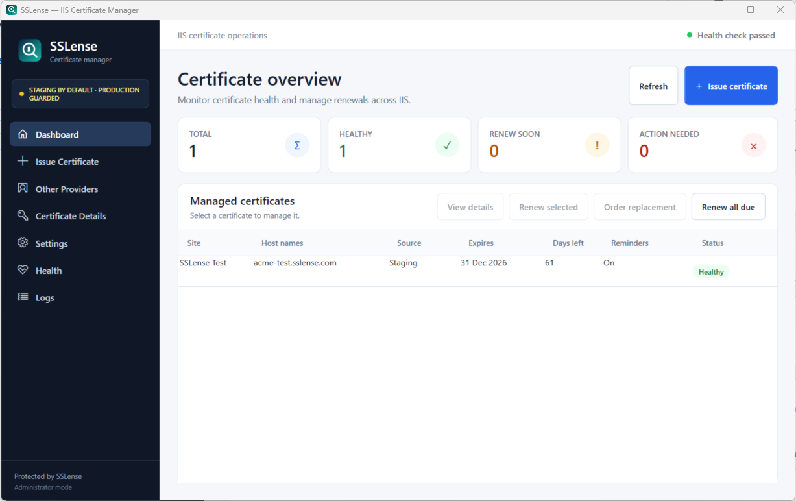
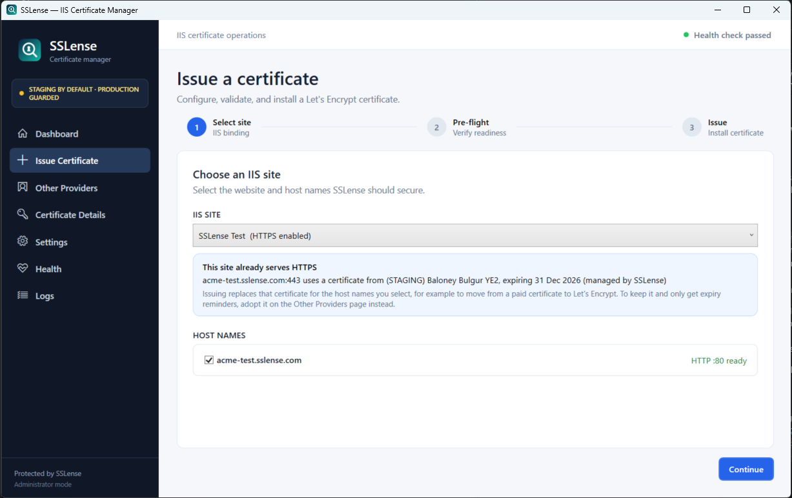
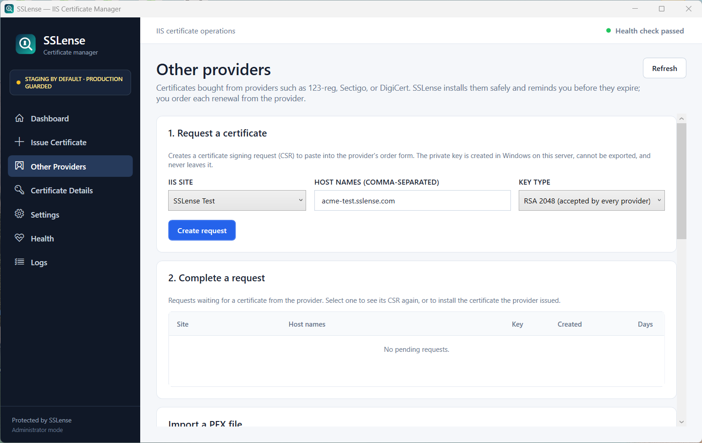
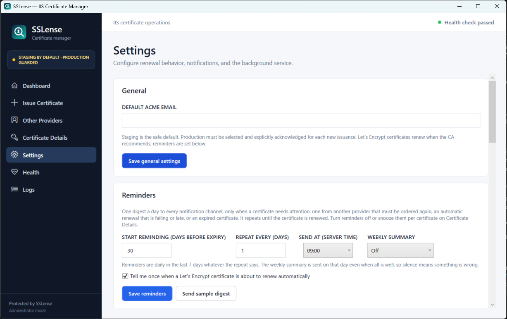

# SSLense

**Free SSL certificates for IIS, installed and renewed automatically, and a reminder before any certificate expires.**

[](https://github.com/panchalvimaldev/sslense/actions/workflows/ci.yml)
[](https://github.com/panchalvimaldev/sslense/releases)
[](LICENSE)

SSLense is a Windows application for IIS administrators. It gets free Let's Encrypt certificates onto your IIS sites and keeps them renewed. It also keeps track of the certificates you buy from providers such as 123-reg, Sectigo or DigiCert, and tells you in time to order the next one. It comes with a desktop app, a command line, and a background service. Website: [sslense.com](https://sslense.com).



## Why SSLense

- **A failed renewal never takes a site down.** After every change, SSLense connects to the site over HTTPS to check the new certificate is really served. If it isn't, the previous binding is restored automatically.
- **Certificates from any provider, not only Let's Encrypt.** It creates the certificate request with a private key that never leaves the server, installs what the provider issues with the same safety checks, or simply starts watching a certificate that is already in IIS.
- **No need to log on to the server to check expiry dates.** One digest a day, sent only when something needs attention, by email (any SMTP setup, including Microsoft 365 relays), Teams, Slack, Discord, Telegram, ntfy, or the Windows Event Log.
- **Problems explained, with a fix for each one.** A health check covers the service, permissions, IIS, DNS, port 80, and Let's Encrypt. A redacted diagnostic bundle can be attached to a bug report.
- **Secure by default.** Private keys are non-exportable, no PFX files are kept, secrets are encrypted with Windows DPAPI, and SSLense's data folder is restricted to Administrators and SYSTEM.
- **Free and open source** under the Apache License 2.0, including commercial use.

## Quick start

1. Download the latest `SSLense-<version>-x64.msi` from [Releases](https://github.com/panchalvimaldev/sslense/releases) and run it on the IIS server. It installs the desktop app, the command line, and the renewal service. No separate .NET installation is needed. Releases are not code-signed yet, so Windows SmartScreen may warn; each release lists a SHA-256 checksum to verify the download.
2. Open **SSLense** from the Start menu.
3. Then either:
   - **Let's Encrypt:** **Issue Certificate**, choose the site and host names, run the pre-flight checks, and issue. Use staging first; production needs an explicit confirmation. The site needs a public DNS record and a port 80 binding.
   - **A certificate you bought:** **Other Providers** → select the site's HTTPS binding → **Adopt selected**.
4. Under **Settings**, add an email or chat channel and click **Send test**, then check **Settings → Reminders**.

From then on the service renews Let's Encrypt certificates on its own, and the daily digest reminds you about anything that needs you. Everything in the app is also available from the command line; see [CLI usage](#cli-usage).

<details>
<summary><b>More screenshots</b></summary>

**Issue a certificate:** pick the site and host names. A site that already serves HTTPS shows which certificate it uses.



**Other providers:** create a request for a certificate you buy elsewhere, complete it, import a PFX, or adopt one already in IIS.



**Settings → Reminders:** when the daily digest starts, how often it repeats, and when it is sent.



</details>

## Get involved

- **Questions and ideas:** [GitHub Discussions](https://github.com/panchalvimaldev/sslense/discussions). **Bugs:** [Issues](https://github.com/panchalvimaldev/sslense/issues); run `SSLense.Cli diagnostics` and attach the bundle.
- **Contributing:** start with issues labelled [good first issue](https://github.com/panchalvimaldev/sslense/labels/good%20first%20issue) and read [CONTRIBUTING.md](CONTRIBUTING.md). The test suite runs on any Windows machine with the .NET 10 SDK. It needs no Administrator rights, never changes IIS, and never contacts Let's Encrypt.
- **What's planned:** [ROADMAP.md](ROADMAP.md). **Security reports:** [SECURITY.md](SECURITY.md).

---

The rest of this page is the reference: requirements, building, every CLI command, notifications, the service, the GUI, data files, and troubleshooting.

> SSLense defaults to Let's Encrypt **staging**. Production issuance is guarded by an explicit choice and acknowledgement. Development and automated tests never contact the production endpoint.

## Requirements

- Windows Server or Windows with IIS installed
- IIS Management Scripts and Tools
- Nothing extra when installed from the MSI (the apps are self-contained); the .NET 10 SDK to build from source
- Administrator access
- An IIS HTTP binding on port 80 for every requested host
- Public HTTP access to `/.well-known/acme-challenge/` for HTTP-01 validation

If the IIS machine has no public IP, a Cloudflare Tunnel can route the hostname to the local IIS HTTP binding. The tunnel route must preserve the expected host header.

## Build and test

From an Administrator PowerShell terminal in the repository:

```powershell
dotnet build .\SSLense.sln
dotnet test .\SSLense.sln
```

## Building the installer

`installer\build.ps1` publishes the GUI, CLI, and service as self-contained x64 apps (the server needs no .NET installation) and builds `artifacts\installer\SSLense-<version>-x64.msi`. The version comes from `Directory.Build.props`; increase it for every release so upgrades apply.

The installer uses WiX Toolset v7, which requires accepting its [Open Source Maintenance Fee EULA](https://wixtoolset.org/osmf/). Read the EULA (`OSMFEULA.txt` in the `WixToolset.Sdk` package), then either pass `-AcceptWixEula` on each build or accept it once for your Windows account:

```powershell
dotnet build .\installer\SSLense.Installer -t:AcceptEula -p:EulaId=wix7
.\installer\build.ps1
```

The installer project is not part of `SSLense.sln`, so `dotnet build` and `dotnet test` never need WiX.

Release settings live in one place each:

- **Version, publisher, and product name:** `Directory.Build.props` (`Version`, `Company`, `Product`). These feed the program files' properties, Add/Remove Programs, and the MSI. The publisher must match the name on the code-signing certificate.
- **Branding:** `assets\branding` holds the icon (`sslense.ico`, 16–256 px) used by the executables, the GUI window and sidebar, the Start menu shortcut, and Add/Remove Programs, plus the SVG sources and the horizontal logo.
- **Bundled .NET runtime:** `build.ps1 -RuntimeVersion` (default `10.0.14`). Raise it to the latest .NET 10 servicing release before each SSLense release so customers receive runtime security fixes.

## Installing with the MSI

```powershell
msiexec /i SSLense-0.9.0-x64.msi                      # interactive
msiexec /i SSLense-0.9.0-x64.msi /qn                  # silent
msiexec /i SSLense-0.9.0-x64.msi /qn START_SERVICE=0  # silent, service installed but not started
msiexec /x SSLense-0.9.0-x64.msi /qn                  # silent uninstall
```

An interactive install shows the Apache-2.0 license, which must be accepted before **Install** is enabled; silent installs skip all dialogs. The MSI installs to `C:\Program Files\SSLense` (`gui`, `cli`, and `service` folders), registers and starts the `SSLense` renewal service as LocalSystem with restart-on-failure actions, adds a Start menu shortcut and an Add/Remove Programs entry, adds the CLI folder to the system `PATH`, and restricts `C:\ProgramData\SSLense`. Upgrades stop the service, replace the files, and start it again. A failed installation or upgrade is rolled back by Windows Installer.

Uninstalling removes the program and the service but **keeps** `C:\ProgramData\SSLense` (certificates, accounts, and settings) and leaves existing IIS bindings and certificates in place, so sites keep working. Delete that folder manually to remove all SSLense data.

If you previously registered the service with `install-service` during development, run `uninstall-service` before installing the MSI; Windows Installer cannot take over an existing service registration.

## CLI usage

List IIS sites and bindings:

```powershell
dotnet run --project .\src\SSLense.Cli -- list-sites
```

Issue and install a staging certificate:

```powershell
dotnet run --project .\src\SSLense.Cli -- issue `
  --site "My IIS Site" `
  --hosts example.com,www.example.com `
  --email admin@example.com `
  --staging
```

Use `--force` to replace an existing valid staging certificate. The command imports the certificate into `LocalMachine\My`, creates or updates SNI bindings, connects to each started site over HTTPS to confirm the new certificate is actually served, and saves the managed-certificate record. If the served certificate does not match within 15 seconds, the previous bindings are restored and the new certificate is removed. Existing SSL flags on a binding, such as disabled HTTP/2, are preserved.

Every CLI command except `--help` requires an elevated (Administrator) terminal.

After staging succeeds, production issuance requires both production flags:

```powershell
dotnet run --project .\src\SSLense.Cli -- issue `
  --site "My IIS Site" `
  --hosts example.com,www.example.com `
  --email admin@example.com `
  --production `
  --accept-production-risk
```

Staging and production use separate DPAPI-protected ACME accounts. The certificate private key is installed as non-exportable, and SSLense does not retain the transient PFX. `--output` saves only the public certificate PEM.

Show managed certificates:

```powershell
dotnet run --project .\src\SSLense.Cli -- status
```

Renew certificates according to the CA's ACME Renewal Information (ARI) window. If ARI is unavailable, SSLense uses a lifetime-relative schedule capped by the configured threshold:

```powershell
dotnet run --project .\src\SSLense.Cli -- renew --all
dotnet run --project .\src\SSLense.Cli -- renew --site "My IIS Site"
```

Exercise the complete staging renewal and safe-binding swap immediately:

```powershell
dotnet run --project .\src\SSLense.Cli -- renew --site "My IIS Site" --force
```

SSLense removes an old certificate only after the replacement binding is confirmed and no other IIS binding references the old thumbprint.

### Certificates from other providers (bring your own)

Some sites use a certificate bought from a provider such as 123-reg, Sectigo or DigiCert. In the desktop app, use the **Other Providers** page. SSLense installs and binds these certificates with the same safeguards (validation first, HTTPS verification, automatic rollback) and reminds you to order the next one. It never tries to renew them itself.

Order a certificate with a request (CSR) created on this server. The private key is a non-exportable machine key that never leaves the server:

```powershell
SSLense.Cli csr --site "Shop" --hosts shop.example.com,www.shop.example.com   # saves sslense-shop.example.com-<date>.csr on the Desktop
# Paste the request into the provider's order form. When the certificate is issued:
SSLense.Cli complete --site "Shop" --certificate .\shop_example_com.crt --chain .\shop_example_com.ca-bundle
SSLense.Cli pending                        # open requests
SSLense.Cli cancel-request --site "Shop"   # abandon a request and delete its key
```

`--key rsa3072` or `--key ec256` changes the key type (default `rsa2048`, which every provider accepts). Certificate files can be PEM (`.crt`, `.pem`, including several certificates in one file) or DER (`.cer`). For `.p7b` bundles, export the certificates as Base-64 `.cer` first.

Import a certificate that already has its key, or start monitoring one that is already bound in IIS without changing anything:

```powershell
SSLense.Cli import --site "Shop" --pfx .\shop.pfx      # password prompted; --hosts defaults to the site's covered host names
SSLense.Cli discover                                   # HTTPS bindings and whether SSLense manages them
SSLense.Cli adopt --site "Shop"                        # --thumbprint when the site uses several certificates
```

Before anything changes, SSLense checks that the certificate covers the hosts, is currently valid, is meant for server authentication, matches the private key, and chains to a trusted root (missing intermediates are reported with a hint to use `--chain`). Replacing a certificate SSLense renews from Let's Encrypt needs `--force`. The previous certificate is left in the certificate store.

Imported certificates are included in the daily reminder digest from 30 days before expiry (configurable) until they are replaced; see [Reminders](#reminders). `renew` skips them, and `status` shows them as renewed manually.

## Notifications

SSLense sends renewal failures immediately, a daily reminder digest when a certificate needs attention, and (optionally) successful renewals. Every organisation's mail and chat setup differs, so channels can be combined freely; configure them under **Settings** in the GUI or with `SSLense.Cli notifications`. Passwords and URLs are encrypted with DPAPI, typed without echo, and never logged or displayed; only their host names are shown.

| Channel | Setup | Notes |
|---|---|---|
| **Windows Event Log** | None; on by default | Application log, source `SSLense`. Lets existing monitoring (Azure Monitor, SCOM, Zabbix, PRTG, and others) watch SSLense |
| **Email** | Any SMTP server or relay | No sign-in (relay by IP address) or username and password; STARTTLS, TLS on connect (465), or plain text for internal relays only |
| **Microsoft Teams, Slack, Discord, Telegram** | Paste a webhook URL | Sent in each service's native format |
| **ntfy** | Paste a topic URL | Free push notifications to the ntfy phone app, no account needed |
| **Generic webhook** | Paste a URL | JSON with `kind`, `severity`, `subject`, `body`, and `occurredAtUtc` |
| **Heartbeat** | Paste a ping URL | healthchecks.io, Uptime Kuma, and similar; see below |

### Email

Presets fill in common settings, which can all be changed: `m365-relay`, `m365`, `gmail`, `sendgrid`, `exchange`, and `custom`.

```powershell
# Microsoft 365 relay that accepts mail by this server's IP address (inbound connector), no sign-in:
SSLense.Cli notifications email --preset m365-relay --host contoso-com.mail.protection.outlook.com `
  --from alerts@contoso.com --to ops@contoso.com,admin@contoso.com

# A server that needs a login; the password is prompted:
SSLense.Cli notifications email --host smtp.example.com --port 587 --auth password --user sslense@example.com `
  --from sslense@example.com --to admin@example.com
```

`--security auto` (the default) uses TLS on connect for port 465 and requires STARTTLS on any other port; it never silently falls back to plain text. Use `--security none` only for an internal relay on a trusted network. Sending a password without encryption is refused.

### Chat and push

```powershell
SSLense.Cli notifications chat --type teams --name ops      # URL prompted
SSLense.Cli notifications chat --type ntfy                  # for example https://ntfy.sh/your-secret-topic
```

- **Teams:** in the channel, create a Workflows flow from the template *Post to a channel when a webhook request is received* and use its URL. SSLense sends an Adaptive Card.
- **Telegram:** `https://api.telegram.org/bot<token>/sendMessage?chat_id=<chat id>`.
- **ntfy:** choose a topic name that is hard to guess, since anyone who knows it can read it on the public server.

### Heartbeat

```powershell
SSLense.Cli notifications heartbeat    # URL prompted
```

The service pings the URL after every **healthy** hourly check. The pings stop when the server or service stops, or while renewals keep failing, so the monitoring service alerts you in either case, even with no other channel configured. Set the check to expect a ping every hour with a grace period of two to three hours.

### Reminders

Once a day (from 09:00 server time by default) the service sends one digest to every channel, but only when something needs attention:

- a certificate from another provider within the reminder window (from 30 days before expiry by default), repeated daily or every few days until it is replaced;
- an automatic renewal that is failing or overdue;
- an expired certificate.

Automatic (Let's Encrypt) certificates also get one notice when they enter the window, saying when they will be renewed. Renewal failures are still sent immediately as they happen, even for a certificate whose reminders are off. A certificate from another provider that is replaced outside SSLense, for example through IIS Manager, is noticed within the hour and its reminders stop.

In the app, the settings are under **Settings → Reminders** (with **Send sample digest**), the Dashboard has a **Reminders** column, and **Certificate Details** turns reminders on, snoozes them for 7 or 30 days, or turns them off until the certificate is replaced or permanently. From the CLI:

```powershell
SSLense.Cli reminders show                                     # settings and each certificate's state
SSLense.Cli reminders set --start-days 45 --repeat-days 2 --send-at 8 --weekly monday
SSLense.Cli reminders site --site "Shop" --mode snooze --days 7  # or on, off-until-replaced, off
SSLense.Cli reminders preview                                  # print today's digest without sending it
SSLense.Cli reminders send-sample                              # send it, marked as a sample
```

The design is in [docs/design/expiry-reminders.md](docs/design/expiry-reminders.md).

### Event Log IDs

| Event ID | Level | Meaning |
|---|---|---|
| 1000 | Information | Certificate renewed |
| 1001 | Error | Renewal failed (sent on the third consecutive failure, then about daily) |
| 1002 | Warning or Information | Reminder digest: certificates need attention, or (Information) only upcoming automatic renewals or the weekly summary |
| 1003 | Error | Reminder digest including a certificate that expires within 7 days or has expired |
| 1900 | Information | Test notification |

These IDs are stable across releases. Successful renewals are always recorded in the Event Log; `--notify-success on` also sends them to email and chat.

### Managing channels

```powershell
SSLense.Cli notifications show                                       # what is configured
SSLense.Cli notifications test                                       # test each channel, PASS or FAIL per channel
SSLense.Cli notifications options --event-log on --notify-success off
SSLense.Cli notifications remove --chat 2                            # or --email
SSLense.Cli notifications heartbeat --remove
SSLense.Cli notifications clear                                      # remove every channel; the Event Log stays on
```

Settings from earlier versions (one SMTP server and one webhook) are migrated automatically; the original `config.json` is kept as `config.json.v1.bak`.

## Windows Service

Publish and install the renewal service:

```powershell
dotnet publish .\src\SSLense.Service -c Release -o .\publish\service
dotnet run --project .\src\SSLense.Cli -- install-service `
  --service-path ".\publish\service\SSLense.Service.exe"
```

The `SSLense` service checks immediately after startup and then every hour. Each check is cheap: certificates that are not due are skipped, and ACME Renewal Information is cached for the period the CA requests (6 hours by default).

Failed renewals are retried from a saved schedule, so retries survive service restarts and reboots:

| Consecutive failures | Next automatic attempt |
|---|---|
| 1 | after 1 hour |
| 2 | after 2 hours |
| 3 or more | every 6 hours (hourly once the certificate is within 2 days of expiry) |
| Let's Encrypt rate limit | after 24 hours, because retrying sooner only extends the limit |

The service sends a failure notification on the third consecutive failure and about once a day after that, and immediately for a rate limit. Manual renewals from the GUI or CLI ignore the backoff, run immediately, and always notify on failure. `status` shows the failure count and the next automatic attempt. Existing IIS bindings remain in place when issuance fails. The service is registered to restart one minute after each of its first three unexpected exits in a day.

Expiry is monitored separately from renewal, so an alert is still sent if renewal itself is broken. Each level is sent once per certificate; the thresholds scale with the certificate lifetime:

| Level | 90-day certificate | 45-day certificate | 6-day certificate |
|---|---|---|---|
| Expires soon (lifetime ÷ 6, at most 14 days) | 14 days left | 7.5 days left | 1 day left |
| Expires very soon (lifetime ÷ 18, at most 3 days) | 3 days left | 2.5 days left | 8 hours left |
| Expired | at expiry | at expiry | at expiry |

On startup the service, GUI, and CLI complete or abandon interrupted certificate operations. A problem with one operation is logged as a warning and never prevents startup.

Check or remove the service:

```powershell
Get-Service SSLense
dotnet run --project .\src\SSLense.Cli -- uninstall-service
```

## Desktop GUI

Start the WPF dashboard from PowerShell or Visual Studio:

```powershell
dotnet run --project .\src\SSLense.Gui
```

Windows displays an administrator elevation prompt because the application manifest requests `requireAdministrator`. The GUI provides:

- A professional application shell with consistent navigation, typography, controls, and operation feedback
- Dashboard summary cards for total, healthy, expiring, and failed certificates
- A certificate table with readable health badges that do not rely on full-row coloring
- Immediate renewal of the selected certificate
- Renewal checks for all due certificates
- Cancellable operations with live progress
- A live log viewer with level filtering and access to the log folder
- A visual three-step issuance wizard with IIS selection, guarded environment choice, pre-flight checks, live progress, and cancellation
- Certificate details, renewal, confirmed removal, bindings, issuer, validity, and recent logs
- An **Other Providers** page for certificates bought elsewhere: create a request (CSR) to copy or save, complete it with the issued certificate and bundle, import a PFX, or adopt a certificate already bound in IIS. Imported certificates show as "Imported" on the Dashboard, with "Order renewal" when 30 days or fewer remain
- General, notification, reminder, and Windows Service settings; per-certificate reminders on Certificate Details

Staging remains the wizard default. Production requires a separate selection and acknowledgement before the Issue button is enabled. Use **Issue certificate** on the Dashboard to open the wizard. Removing a certificate requires confirmation and removes only matching HTTPS bindings; a certificate still used by another IIS site is retained in the Windows certificate store.

The same operations from the command line:

```powershell
dotnet run --project .\src\SSLense.Cli -- preflight --site "My IIS Site" --hosts example.com
dotnet run --project .\src\SSLense.Cli -- details --site "My IIS Site"
dotnet run --project .\src\SSLense.Cli -- configure --email admin@example.com --renewal-days 30
dotnet run --project .\src\SSLense.Cli -- service-status
dotnet run --project .\src\SSLense.Cli -- start-service
dotnet run --project .\src\SSLense.Cli -- stop-service
```

Certificate removal is destructive and therefore requires explicit CLI confirmation:

```powershell
dotnet run --project .\src\SSLense.Cli -- remove --site "My IIS Site" --yes
```

## Data and logs

SSLense stores files under `C:\ProgramData\SSLense`:

- `config.json`: non-secret settings and DPAPI-protected notification values
- `managed-certificates.json`: sites, hosts, certificate dates, thumbprints, and renewal results
- `account-key.staging.dat`: DPAPI-protected staging ACME account key
- `account-key.production.dat`: separate DPAPI-protected production ACME account key, created only when production is used
- `account-key.<authority-id>.dat`: one DPAPI-protected ACME account key for each other certificate authority, when configured
- `pending-requests.json`: open certificate requests (CSRs) for certificates from other providers; the matching private keys are non-exportable keys in the Windows machine key store, never files
- `certificates\`: saved public certificate PEM files; transient PFX data is not retained
- `locks\`: per-site cross-process operation locks shared by the GUI, CLI, and service
- `transactions\`: durable certificate-operation journals, normally removed automatically after commit or recovery
- `challenges\`: records of HTTP-01 challenge files written into a site, so files left by an interrupted validation are removed at the next start (only once the process that wrote them has exited)
- `service-heartbeat.json`: when the renewal service last started and completed a cycle, used by the health check
- `reminder-state.json`: the day the last reminder digest and weekly summary were handled, so a restart never sends one twice
- `logs\sslense-YYYYMMDD.log`: rolling logs retained for 30 days

`config.json`, `managed-certificates.json`, `pending-requests.json`, and transaction journals carry a `schemaVersion`. Before SSLense first rewrites a file from an older schema, it saves the original as `<file>.v<old version>.bak` (for example `managed-certificates.json.v0.bak`). A file written by a newer SSLense version is never modified: SSLense stops with a message to install the newer version, so a downgrade cannot corrupt state.

Private keys, PFX passwords, SMTP passwords, webhook URLs, and the ACME account key must never appear in logs.

### Data directory permissions

DPAPI `LocalMachine` protection lets any account on the machine decrypt a protected value it can read, so folder permissions are what actually protect SSLense's secrets. Every time the service, GUI, or an elevated CLI starts, SSLense:

- restricts `C:\ProgramData\SSLense` to **Administrators** and **SYSTEM** (the service account), removing the default ProgramData access for Users;
- makes Administrators the owner of the folder and everything in it, because a previous owner could otherwise change the permissions back;
- removes any extra permissions on files inside, so everything inherits the restricted rules.

SSLense never creates links in this folder. If it finds a symbolic link, junction, or file with more than one hard link, it **changes nothing** and logs a warning naming the item, because Windows would otherwise apply the permission change through the link to a location outside the folder. Remove the item and start SSLense again.

Check the current state at any time (read-only; exits with code 1 if there is a problem):

```powershell
dotnet run --project .\src\SSLense.Cli -- check-permissions
```

The service runs as LocalSystem. Running it under a different account would also require granting that account access to this folder.

## Health check and diagnostics

Run the health check first when something is wrong. It is read-only, apart from a probe file that the pre-flight check writes to each site's challenge folder and removes:

```powershell
SSLense.Cli health
```

It checks elevation, data-folder permissions, configuration and state files, interrupted operations, the renewal service and its heartbeat (the service records each hourly cycle), IIS, and, for every managed certificate, that it is installed with its private key, bound on port 443, not close to expiry, and renewing successfully. It then checks DNS, port 80 reachability, and the challenge folder for each host, outbound HTTPS to Let's Encrypt (a read-only request for the ACME directory of each environment in use), and whether a notification channel is configured. Each problem comes with a suggested fix. The exit code is 1 if any check failed and 0 otherwise, warnings included, so it can be used in monitoring scripts.

To ask for help, create a diagnostic bundle and attach it to a GitHub issue:

```powershell
SSLense.Cli diagnostics                  # sslense-diagnostics-<timestamp>.zip on your Desktop
SSLense.Cli diagnostics --redact-hosts   # also replaces site and host names, for public posts
```

The bundle contains a system summary (SSLense, Windows, .NET, and IIS versions), the health check results, configuration, managed certificates, IIS sites and bindings, interrupted operations, the service heartbeat, and the three newest log files. It never contains private keys, ACME account keys, PFX files, SMTP passwords, webhook URLs, or DPAPI-protected values. Email addresses are masked, and URL paths and query strings are removed except for Let's Encrypt and HTTP-01 challenge URLs. Thumbprints are kept because they are public identifiers. Review the files before sharing them.

The GUI's **Health** page runs the same checks and saves the bundle to your Desktop.

## Troubleshooting

- **Access denied:** run PowerShell as Administrator.
- **IIS sites cannot be read:** install IIS Management Scripts and Tools.
- **HTTP-01 returns 404:** confirm the hostname's port 80 IIS binding, tunnel host header, and that `/.well-known/acme-challenge/<token>` reaches the same site.
- **HTTP-01 returns unexpected content:** check authentication, URL Rewrite, MVC routing, proxies, and cached responses for the challenge path.
- **ACME validation times out:** confirm public DNS/tunnel routing and that inbound HTTP remains available throughout validation.
- **SMTP test fails:** verify the port, TLS mode, credentials, outbound firewall policy, and provider-specific authentication requirements.
- **Webhook test fails:** verify that the receiving endpoint accepts an HTTP POST containing `kind`, `subject`, `body`, and `occurredAtUtc` JSON fields.

Review the current daily log in `C:\ProgramData\SSLense\logs` for the full exception and remediation context. Sensitive values are excluded.

## Contributing, security, and support

- **Contributing:** see [CONTRIBUTING.md](CONTRIBUTING.md). Commits are signed off under the Developer Certificate of Origin.
- **Website:** [sslense.com](https://sslense.com) is the static site in [`site/`](site/), deployed by Cloudflare (Workers static assets, `site/wrangler.jsonc`) whenever `site/` changes; there is no build step.
- **Security issues:** report them privately as described in [SECURITY.md](SECURITY.md), never in a public issue.
- **Bugs and questions:** open a GitHub issue with the output of `SSLense.Cli health` and a bundle from `SSLense.Cli diagnostics` (add `--redact-hosts` if your host names are private).

## License

SSLense is licensed under the [Apache License 2.0](LICENSE); see [NOTICE](NOTICE). Third-party components and their licenses are listed in [THIRD-PARTY-NOTICES.md](THIRD-PARTY-NOTICES.md). The SSLense name and logo are covered by [TRADEMARKS.md](TRADEMARKS.md), not by the code license.
