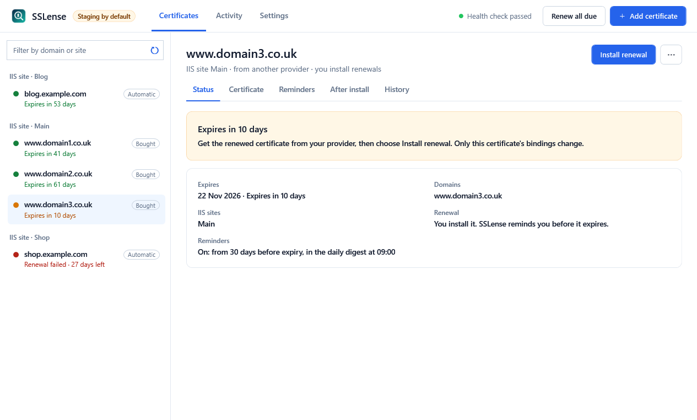
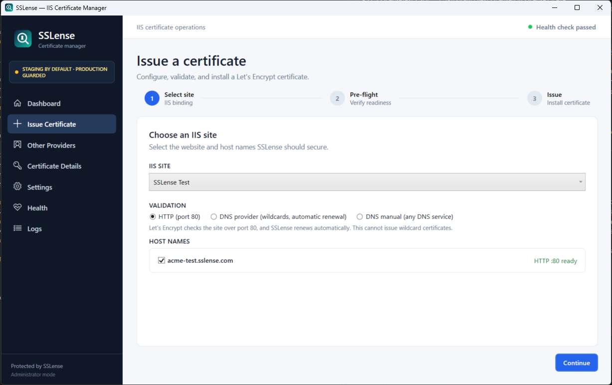
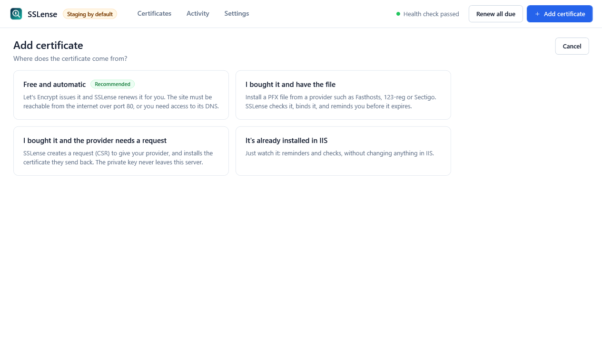
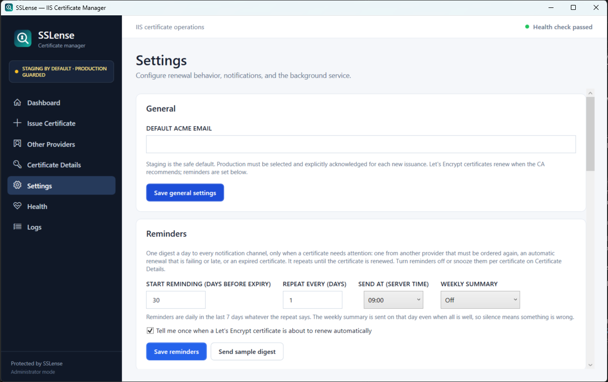

# SSLense

**Free SSL certificates for IIS, installed and renewed automatically, and a reminder before any certificate expires.**

[](https://github.com/panchalvimaldev/sslense/actions/workflows/ci.yml)
[](https://github.com/panchalvimaldev/sslense/releases)
[](LICENSE)

SSLense is a Windows application for IIS administrators. It gets free Let's Encrypt certificates onto your IIS sites and keeps them renewed. It also keeps track of the certificates you buy from providers such as 123-reg, Sectigo or DigiCert, and tells you in time to order the next one. It comes with a desktop app, a command line, and a background service. Website: [sslense.com](https://sslense.com).



## Why SSLense

- **A failed renewal never takes a site down.** After every change, SSLense connects to the site over HTTPS to check the new certificate is really served. If it isn't, the previous binding is restored automatically.
- **One certificate across several IIS sites.** A DNS-validated certificate, such as `*.example.com`, can serve several sites that renew together. If one site has a problem, the others are protected.
- **Wildcard certificates and sites without port 80.** DNS validation issues `*.example.com`, and works for internal servers and sites that cannot open port 80. It renews automatically through Cloudflare, through acme-dns with one CNAME at any DNS host, through your own PowerShell script for any DNS service with an API, or through a CNAME from any DNS service to a domain on Cloudflare.
- **Certificates for more than IIS.** After every renewal, SSLense can give an application pool or service access to the private key, restart a service, or run a script, with ready-made scripts for Remote Desktop, SQL Server, and Exchange. A certificate only for such a service needs no IIS site. With an exportable key, it can also be written to PFX or PEM files, or to the IIS Central Certificate Store for web farms.
- **Any ACME certificate authority, not only Let's Encrypt.** ZeroSSL, Google Trust Services, SSL.com, Sectigo, or your own internal CA, with External Account Binding, renewed automatically like Let's Encrypt.
- **Certificates from any provider.** For one bought without ACME, it creates the certificate request with a private key that never leaves the server, installs what the provider issues with the same safety checks, or simply starts watching a certificate that is already in IIS.
- **No need to log on to the server to check expiry dates.** One digest a day, sent only when something needs attention, by email (any SMTP setup, including Microsoft 365 relays), Teams, Slack, Discord, Telegram, ntfy, or the Windows Event Log.
- **Problems explained, with a fix for each one.** A health check covers the service, permissions, IIS, DNS, port 80, and Let's Encrypt. A redacted diagnostic bundle can be attached to a bug report.
- **Secure by default.** Private keys are non-exportable, no PFX files are kept, secrets are encrypted with Windows DPAPI, and SSLense's data folder is restricted to Administrators and SYSTEM.
- **Free and open source** under the Apache License 2.0, including commercial use.

## Quick start

1. Download the latest `SSLense-<version>-x64.msi` from [Releases](https://github.com/panchalvimaldev/sslense/releases) and run it on the IIS server. It installs the desktop app, the command line, and the renewal service. No separate .NET installation is needed. Releases are not code-signed yet, so Windows SmartScreen may warn; each release lists a SHA-256 checksum to verify the download.
2. Open **SSLense** from the Start menu.
3. Then either:
   - **Let's Encrypt:** **Add certificate** → **Free and automatic**, choose the site and host names, run the pre-flight checks, and issue. Use staging first; production needs an explicit confirmation. With HTTP validation, the site needs a public DNS record and a port 80 binding. For a wildcard, or without port 80, choose DNS validation; see [DNS validation and wildcard certificates](#dns-validation-and-wildcard-certificates).
   - **A certificate you bought:** **Add certificate** → **It's already installed in IIS** → tick its HTTPS binding → **Watch**. When it is due, select it and choose **Install renewal**.
4. Under **Settings**, add an email or chat channel and click **Send test**, then check **Settings → Reminders**.

From then on the service renews Let's Encrypt certificates on its own, and the daily digest reminds you about anything that needs you. Everything in the app is also available from the command line; see [CLI usage](#cli-usage).

<details>
<summary><b>More screenshots</b></summary>

**Add certificate, free and automatic:** pick the site and host names. A site that already serves HTTPS shows which certificate it uses.



**Add certificate:** first, where the certificate comes from: free and automatic, bought with its file, bought and the provider needs a request (CSR), or already installed in IIS.



**Settings → Reminders:** when the daily digest starts, how often it repeats, and when it is sent.



</details>

## Get involved

- **Questions and ideas:** [GitHub Discussions](https://github.com/panchalvimaldev/sslense/discussions). **Bugs:** [Issues](https://github.com/panchalvimaldev/sslense/issues); run `SSLense.Cli diagnostics` and attach the bundle.
- **Contributing:** start with issues labelled [good first issue](https://github.com/panchalvimaldev/sslense/labels/good%20first%20issue) and read [CONTRIBUTING.md](CONTRIBUTING.md). The test suite runs on any Windows machine with the .NET 10 SDK. It needs no Administrator rights, never changes IIS, and never contacts Let's Encrypt.
- **What's planned:** [ROADMAP.md](ROADMAP.md). **Security reports:** [SECURITY.md](SECURITY.md).
- **Support the project:** SSLense is free and maintained voluntarily. [GitHub Sponsors](https://github.com/sponsors/panchalvimaldev) helps pay for test servers and maintenance.

---

The rest of this page is the reference: requirements, building, every CLI command, notifications, the service, the GUI, data files, and troubleshooting.

> SSLense defaults to Let's Encrypt **staging**. Production issuance is guarded by an explicit choice and acknowledgement. Development and automated tests never contact the production endpoint.

## Requirements

- Windows Server or Windows with IIS installed
- IIS Management Scripts and Tools
- Nothing extra when installed from the MSI (the apps are self-contained); the .NET 10 SDK to build from source
- Administrator access
- For HTTP validation: an IIS HTTP binding on port 80 for every requested host, and public HTTP access to `/.well-known/acme-challenge/`
- For DNS validation: an IIS HTTP or HTTPS binding for every requested host, and a name in public DNS. Port 80 and public access to the server are not needed. Automatic renewal needs a Cloudflare zone

If the IIS machine has no public IP, a Cloudflare Tunnel can route the hostname to the local IIS HTTP binding. The tunnel route must preserve the expected host header.

## Build and test

From an Administrator PowerShell terminal in the repository:

```powershell
dotnet build .\SSLense.sln
dotnet test .\SSLense.sln
```

## Building the installer

`installer\build.ps1` publishes the GUI, CLI, and service as self-contained x64 apps (the server needs no .NET installation) and builds `artifacts\installer\SSLense-<version>-x64.msi`. The version comes from `Directory.Build.props`; increase it for every release so upgrades apply.

The installer uses WiX Toolset v7, which requires accepting its [Open Source Maintenance Fee EULA](https://wixtoolset.org/osmf/). Read the EULA (`OSMFEULA.txt` in the `WixToolset.Sdk` package), then either pass `-AcceptWixEula` on each build or accept it once for your Windows account:

```powershell
dotnet build .\installer\SSLense.Installer -t:AcceptEula -p:EulaId=wix7
.\installer\build.ps1
```

The installer project is not part of `SSLense.sln`, so `dotnet build` and `dotnet test` never need WiX.

Release settings live in one place each:

- **Version, publisher, and product name:** `Directory.Build.props` (`Version`, `Company`, `Product`). These feed the program files' properties, Add/Remove Programs, and the MSI. The publisher must match the name on the code-signing certificate.
- **Branding:** `assets\branding` holds the icon (`sslense.ico`, 16–256 px) used by the executables, the GUI window and sidebar, the Start menu shortcut, and Add/Remove Programs, plus the SVG sources and the horizontal logo.
- **Bundled .NET runtime:** `build.ps1 -RuntimeVersion` (default `10.0.14`). Raise it to the latest .NET 10 servicing release before each SSLense release so customers receive runtime security fixes.

## Installing with the MSI

```powershell
msiexec /i SSLense-0.9.0-x64.msi                      # interactive
msiexec /i SSLense-0.9.0-x64.msi /qn                  # silent
msiexec /i SSLense-0.9.0-x64.msi /qn START_SERVICE=0  # silent, service installed but not started
msiexec /x SSLense-0.9.0-x64.msi /qn                  # silent uninstall
```

An interactive install shows the Apache-2.0 license, which must be accepted before **Install** is enabled; silent installs skip all dialogs. The MSI installs to `C:\Program Files\SSLense` (`gui`, `cli`, and `service` folders), registers and starts the `SSLense` renewal service as LocalSystem with restart-on-failure actions, adds a Start menu shortcut and an Add/Remove Programs entry, adds the CLI folder to the system `PATH`, and restricts `C:\ProgramData\SSLense`. Upgrades stop the service, replace the files, and start it again. A failed installation or upgrade is rolled back by Windows Installer.

Uninstalling removes the program and the service but **keeps** `C:\ProgramData\SSLense` (certificates, accounts, and settings) and leaves existing IIS bindings and certificates in place, so sites keep working. Delete that folder manually to remove all SSLense data.

If you previously registered the service with `install-service` during development, run `uninstall-service` before installing the MSI; Windows Installer cannot take over an existing service registration.

## CLI usage

List IIS sites and bindings:

```powershell
dotnet run --project .\src\SSLense.Cli -- list-sites
```

Issue and install a staging certificate:

```powershell
dotnet run --project .\src\SSLense.Cli -- issue `
  --site "My IIS Site" `
  --hosts example.com,www.example.com `
  --email admin@example.com `
  --staging
```

Use `--force` to replace an existing valid staging certificate. The command imports the certificate into `LocalMachine\My`, creates or updates SNI bindings, connects to each started site over HTTPS to confirm the new certificate is actually served, and saves the managed-certificate record. If the served certificate does not match within 15 seconds, the previous bindings are restored and the new certificate is removed. Existing SSL flags on a binding, such as disabled HTTP/2, are preserved.

Every CLI command except `--help` requires an elevated (Administrator) terminal.

After staging succeeds, production issuance requires both production flags:

```powershell
dotnet run --project .\src\SSLense.Cli -- issue `
  --site "My IIS Site" `
  --hosts example.com,www.example.com `
  --email admin@example.com `
  --production `
  --accept-production-risk
```

Staging and production use separate DPAPI-protected ACME accounts. The certificate private key is installed as non-exportable, and SSLense does not retain the transient PFX. `--output` saves only the public certificate PEM. To issue from a certificate authority other than Let's Encrypt, use `--ca`; see [Other ACME certificate authorities](#other-acme-certificate-authorities).

Show managed certificates:

```powershell
dotnet run --project .\src\SSLense.Cli -- status
```

Renew certificates according to the CA's ACME Renewal Information (ARI) window. If ARI is unavailable, SSLense uses a lifetime-relative schedule capped by the configured threshold:

```powershell
dotnet run --project .\src\SSLense.Cli -- renew --all
dotnet run --project .\src\SSLense.Cli -- renew --site "My IIS Site"
```

Exercise the complete staging renewal and safe-binding swap immediately:

```powershell
dotnet run --project .\src\SSLense.Cli -- renew --site "My IIS Site" --force
```

SSLense removes an old certificate only after the replacement binding is confirmed and no other IIS binding references the old thumbprint, and, when the certificate has [deployment steps](#deployment-steps-remote-desktop-sql-server-exchange-and-more), after they succeed.

### DNS validation and wildcard certificates

Let's Encrypt only issues wildcard certificates through DNS validation. It also suits internal servers and sites that cannot open port 80. There are four ways to use it:

| Method | Works with | Renewal |
|---|---|---|
| **DNS provider** | Cloudflare | Automatic |
| **acme-dns** | Any DNS host, even one without an API, with one CNAME created once | Automatic |
| **Script** | Any DNS service with an API, through your PowerShell script | Automatic |
| **CNAME delegation** | Any DNS service, plus a domain on Cloudflare or one your script can change | Automatic |
| **Manual** | Any DNS service | By hand, with new records each time |

**Add a provider.** In Cloudflare, go to **My Profile → API Tokens → Create Token** and use the **Edit zone DNS** template for one zone. The zone ID is on the domain's **Overview** page. The token is prompted for, never passed as an argument, and is encrypted on the server with DPAPI. In the app, use **Settings → DNS providers**.

```powershell
SSLense.Cli dns add --provider cloudflare --name "Main" --zone example.com --zone-id <zone-id>
SSLense.Cli dns test --name "Main"     # adds and removes a TXT record at _sslense-test.example.com
SSLense.Cli dns list
SSLense.Cli dns update-token --name "Main"   # for a token that expired or was rotated
SSLense.Cli dns remove --name "Main"   # refused while a certificate renews through it
```

**Issue a certificate.** `--names` lists what the certificate covers, and `--hosts` lists the real IIS bindings to manage. Without `--names`, the certificate covers the hosts. A wildcard covers one level and does not include the base name, so list both if you need both:

```powershell
SSLense.Cli preflight --site "Shop" --validation dns --names "*.example.com,example.com" --hosts "shop.example.com,example.com"
SSLense.Cli issue --site "Shop" --email admin@example.com --validation dns --names "*.example.com,example.com" --hosts "shop.example.com,example.com"
```

**Use any DNS service with a script.** Write a PowerShell script that adds and removes one TXT record through your DNS service's API, and SSLense does the rest: the order, the check that every name server has the record, cleanup, recovery, and renewal. Start from `Template.ps1` in `C:\Program Files\SSLense\dns-scripts\`; `Cloudflare.ps1` there is a complete working example. In the app, choose **Script** under **Settings → DNS providers**.

```powershell
SSLense.Cli dns add --provider script --name "Registrar" --zone example.com --script C:\Scripts\registrar.ps1 --secret
SSLense.Cli dns test --name "Registrar"    # adds a record, waits until every name server has it, removes it
SSLense.Cli dns update-script --name "Registrar" --script C:\Scripts\registrar.ps1   # after you change the script
```

SSLense runs it as `powershell.exe -File <script> -Action Check|Add|Remove -Zone example.com -RecordName _acme-challenge.example.com -Value <value>`. Exit with 0 when the action worked. `--secret` prompts for one secret, such as an API key, which is encrypted and given to the script in the `SSLENSE_DNS_SECRET` environment variable; for two values, use `key:secret`. Each call may run for 2 minutes, or `--timeout` seconds.

- **Read a script before adding it.** The renewal service runs it as **SYSTEM**, so it can do anything on the server.
- **SSLense runs its own copy,** in `C:\ProgramData\SSLense\dns-scripts`, which only administrators can change. It checks the copy's SHA-256 before every run and refuses one that changed. After you edit the original, run `dns update-script`, which checks the new copy before using it. `dns list` shows the hash, to compare with `Get-FileHash` on your original.
- **Test as you, renew as SYSTEM.** `dns test` runs the script as your account; the service runs it as SYSTEM. Install any module it needs for all users (`Install-Module -Scope AllUsers`), and don't rely on anything in your user profile. In the 30 days before each renewal, the service runs the script's `Check` daily, so a problem shows in the digest before the renewal fails.
- **A Group Policy execution policy still applies.** On a server that requires signed scripts, sign the script.

**Use any DNS host with acme-dns.** acme-dns is a small DNS server made only for validation records. You create one CNAME, once, at your DNS host, and SSLense updates only that name on the acme-dns server, with a credential that can change nothing else. Nothing on the server can touch your main zone, and your DNS host needs no API. Use the free public server, `https://auth.acme-dns.io`, or [run your own](https://github.com/joohoi/acme-dns). In the app, choose **acme-dns** under **Settings → DNS providers**.

```powershell
SSLense.Cli dns add --provider acme-dns --name "Shop acme-dns" --domain example.com --server https://auth.acme-dns.io
#   Create this record at your DNS host, then run 'dns test':
#   _acme-challenge.example.com  CNAME  8e57…d1.auth.acme-dns.io
SSLense.Cli dns test --name "Shop acme-dns"   # checks the CNAME, updates the account, waits for its name servers
```

- **One account per domain.** It covers the domain and its wildcard, which use the same record. Add another account for each other name, such as `shop.example.com`, with its own CNAME: an account keeps only its two newest values, so SSLense refuses an order that needs more from one account.
- **The CNAME is checked** before each order and daily. If it is deleted or changed, the digest says so, with the record to create, before a renewal fails.
- `--allow-from 203.0.113.10/32` limits updates to this server's address. `--import` takes an account another tool registered.
- **The public server is run by volunteers, with no promise of uptime,** and whoever runs an acme-dns server can answer validations for the names that point to it. For an important domain, run your own.

**Use another DNS service with CNAME delegation.**
 Create this one permanent record at your DNS service, then use `--validation dns` with a provider for the other zone. If your DNS service can proxy records, as Cloudflare can, turn that off for this one:

```text
_acme-challenge.example.com  CNAME  example-com.acme.example.net
```

**Create the records yourself** with `--validation dns-manual`. SSLense shows each record, waits for you to confirm, and checks they are visible. **A manual certificate cannot renew automatically.** The daily digest reminds you, with the command to run; in the app, select the certificate and choose **Renew by hand**. With shorter certificate lifetimes this becomes frequent work, so CNAME delegation is usually better.

**Good to know:**

- **The token can change every record in its zone,** because Cloudflare grants DNS permissions per zone. Anyone who takes over the server could use it to redirect that domain. For an important domain, use CNAME delegation to a separate zone, so the token can't touch the main one.
- **SSLense only removes TXT records it published.** It leaves other values at the same name alone. If it can't remove one, it tries again when it next starts.
- **It checks before asking Let's Encrypt,** including CAA records and the zone's own name servers, to avoid using up the failed validation limit. If outbound port 53 is blocked, it can't check, so it says so, waits 2 minutes, and continues.
- **To use one wildcard on several IIS sites, share it** with `share add`, described below. Requesting the same wildcard again for another site is refused. Bound by hand and not shared, a certificate isn't updated on that site at renewal, so SSLense warns you about it.
- **`*.example.com` can't be an IIS binding that SSLense manages.** Use real host names in `--hosts`. A host added to the site later isn't bound automatically: the health check reports it, and you run `issue --force` again with the new host in `--hosts`.
- **Other DNS services:** use a script for now. Built-in providers for more services are planned; see [ROADMAP.md](ROADMAP.md).

### Deployment steps: Remote Desktop, SQL Server, Exchange, and more

Other services on the server use certificates too. Deployment steps hand each new certificate to them, after every install and renewal, in order.

```powershell
SSLense.Cli deploy add --site "Shop" --grant-key-access "IIS AppPool\Shop"      # read access to the private key
SSLense.Cli deploy add --site "Shop" --restart-service MSSQLSERVER               # restart, and wait until it runs
SSLense.Cli deploy add --site "Shop" --script C:\Scripts\my-deploy.ps1           # run a PowerShell script
SSLense.Cli deploy list --site "Shop"
SSLense.Cli deploy run --site "Shop"          # run them now, for the certificate in use
SSLense.Cli deploy remove --site "Shop" --step 2
```

In the app, they are under **After install** on the certificate.

Ready-made scripts are in `C:\Program Files\SSLense\deploy-scripts\`, with the steps to add at the top of each:

| Script | What it does | Also add |
|---|---|---|
| `RemoteDesktop.ps1` | Sets the certificate of this server's Remote Desktop listener | `--grant-key-access "NT AUTHORITY\NETWORK SERVICE"` before it |
| `SqlServer.ps1` | Sets the certificate of a SQL Server instance (`MSSQLSERVER` unless you change it) | `--grant-key-access "NT Service\MSSQLSERVER"` before it, `--restart-service MSSQLSERVER` after it |
| `Exchange.ps1` | Enables the certificate for Exchange's SMTP service | `--timeout 600` |
| `Template.ps1` | A starting point for your own | |

- **A failed step never undoes the renewal.** The new certificate is installed and bound in IIS. The failure is reported in notifications, and SSLense retries the steps every hour until they succeed. The previous certificate stays installed until then, because services may still use it.
- **A new step runs after the next renewal,** or at once with `deploy run`. Adding a restart step never restarts the service unasked.
- **Scripts follow the DNS script rules:** SSLense runs its own copy, in `C:\ProgramData\SSLense\deploy-scripts`, checked by hash before every run, as SYSTEM, with a timeout (5 minutes unless `--timeout` says otherwise). A script gets `-Thumbprint`, `-PreviousThumbprint`, `-Hosts` (comma-separated), `-NotAfter`, and `-Site`. After editing the original, remove the step and add it again.
- **Key access adds one read rule** for the account you name, which must exist. It never removes rules.
- Steps belong to the certificate, so a certificate shared by several sites runs them once.

**A certificate with no IIS site.** For a server whose certificate is only for Remote Desktop, SQL Server, or another service, issue it under a name of your choice instead of a site. Nothing is bound in IIS; its deployment steps hand it to the service.

```powershell
SSLense.Cli issue --no-site "Remote Desktop" --names rdp.example.com --validation dns --email ops@example.com
SSLense.Cli deploy add --site "Remote Desktop" --grant-key-access "NT AUTHORITY\NETWORK SERVICE"
SSLense.Cli deploy add --site "Remote Desktop" --script "C:\Program Files\SSLense\deploy-scripts\RemoteDesktop.ps1"
SSLense.Cli deploy run --site "Remote Desktop"
```

- Every command that takes `--site` takes the name too. In the app, tick **No IIS site** in **Add certificate**.
- It needs DNS validation, because HTTP validation needs a site to serve the file. The name must not be an IIS site's.
- Removing it stops managing it and **keeps the certificate in the store**, because services outside IIS may still use it. Delete it in certlm when they no longer do.


### Export: PFX, PEM, and the IIS Central Certificate Store

SSLense installs private keys as non-exportable, which is all IIS needs. For a web farm's Central Certificate Store, software that reads PEM files, or a copy for another server, issue the certificate with an exportable key, then add export steps. They are deployment steps, so they run after every renewal and are retried when they fail.

```powershell
SSLense.Cli issue --site "Shop" --names "*.example.com" --validation dns --exportable-key --email ops@example.com
SSLense.Cli deploy add --site "Shop" --export-pfx D:\Certs\shop.pfx          # password asked for, hidden
SSLense.Cli deploy add --site "Shop" --export-pem D:\Certs\shop               # cert.pem, chain.pem, fullchain.pem, key.pem
SSLense.Cli deploy add --site "Shop" --central-store \\fileserver\ccs         # one PFX per name; the store's password
```

- **The exportable key is a choice per certificate,** made when it is issued and kept at every renewal. To make an existing certificate's key exportable, issue it again with `--exportable-key --force`. In the app, tick **Exportable private key** in **Add certificate**, and add the steps under **After install** on the certificate.
- **The Central Certificate Store** gets `example.com.pfx` for each name, and `_.example.com.pfx` for `*.example.com`, as IIS expects. Use the private key password set for the store in IIS.
- **`key.pem` is not protected by a password,** so SSLense writes it for Administrators, SYSTEM, and the account that wrote it only. Give another account access with Windows' own tools if a service needs it.
- Passwords are encrypted with DPAPI, never logged, and hidden in diagnostic bundles. Files are replaced in one step, so a reader never sees half a file. The service writes as SYSTEM, which reaches a share as the computer's account.

### Key type, chain, and profile

Certificates get an ECDSA P-256 key, the CA's default chain, and the CA's default kind of certificate unless you choose otherwise. Each choice is kept at every renewal. In the app, they are under **Advanced** in **Add certificate**.

```powershell
SSLense.Cli issue --site "Shop" --email ops@example.com --key rsa-3072                     # ecdsa-p256, ecdsa-p384, rsa-2048, rsa-3072, rsa-4096
SSLense.Cli issue --site "Shop" --email ops@example.com --preferred-chain "ISRG Root X1"
SSLense.Cli issue --site "Shop" --email ops@example.com --profile shortlived                # certificates valid about six days
SSLense.Cli ca test --id letsencrypt-staging                                               # lists the CA's profiles
```

- **RSA** suits older clients and appliances that do not accept ECDSA.
- **A preferred chain** is a preference: the default chain is used when the CA offers none to that root.
- **A profile** must be one the CA lists, or SSLense refuses before ordering. A short-lived certificate renews about two days before it expires; keep the renewal service running.
- **`--reuse-key` keeps the same private key at every renewal,** for key pinning or DANE TLSA records. The first certificate gets a new key; renewals sign the request with that key in the Windows store, which never leaves it. If the key is gone or no longer matches `--key`, the renewal uses a new key and says so, rather than let the certificate expire.

### One certificate across several IIS sites


A certificate that uses DNS validation can serve several sites. Issue it for the first site, then add the others. Adding a site orders nothing from the certificate authority.

```powershell
SSLense.Cli issue --site "Shop" --email ops@example.com --validation dns --names "*.example.com,example.com" --hosts "shop.example.com,example.com"
SSLense.Cli share add --from "Shop" --to "Blog" --hosts "blog.example.com"
SSLense.Cli share remove --site "Blog"
```

In the app, use the certificate's **Sites** section.

- **`share add`:** without `--hosts`, it uses every named binding on the site that the certificate covers. If SSLense already manages another certificate for that site, add `--replace-existing`, which stops managing that certificate. A certificate from another provider stays in the store.
- **`share remove`:** SSLense stops managing the site and leaves its binding as it is, so the site keeps working until the certificate expires. If you remove the first site, the next one takes its place. A certificate with one site left is removed with `remove`, and `remove` on a shared certificate removes the bindings on every site.
- **Renewing:** `renew --site` with any of the sites renews them all. Other commands that install a certificate, such as `import` and `csr`, are refused on a site added this way until you run `share remove`. They are refused on the first site too, because an imported certificate can't be shared; `share remove` on the first site hands the shared certificate to the next site.
- **Only DNS validation for now:** HTTP validation would have to reach every site, and certificates from other providers can't be shared yet.

SSLense tries each new certificate before touching a real site, moves sites one at a time, and confirms over HTTPS what each one serves. Moving a site refuses new connections on that site for a moment, about 10 to 20 ms in testing, as any certificate change in IIS does. Browsers normally retry. When a site has a problem:

| Site | More than 7 days left | 7 days or fewer left |
|---|---|---|
| Stopped | Included, without the HTTPS check | Same |
| Deleted, or its binding was removed | Left behind; the others renew | Same |
| Started, but not answering HTTPS | Nothing is ordered or changed | Left behind; the others renew |
| Windows refuses the new certificate | No site changes; tries again after at least 24 hours | Same |
| Fails the HTTPS check after moving | Every site goes back; tries again after at least 24 hours | Only that site goes back; the others renew |

A site left behind keeps its previous certificate, and you're notified with its name. Each service cycle tries to move it without ordering a new certificate, and **Try moving now** or `renew --site` tries straight away. A deleted site stays listed until you run `share remove`, because a renamed site looks the same as a deleted one. The previous certificate stays in the store after a site was left behind, even once it catches up, until you remove it. It does no harm.

The HTTPS checks run from this server, so they show what IIS serves, not what visitors receive through a CDN or load balancer.

**Going back to an older version:** the first save after upgrading to 0.14 changes the format of `managed-certificates.json`, and older versions refuse the new format. SSLense keeps a copy of the old file as `managed-certificates.json.v4.bak`. It doesn't include any changes made since, so going back means restoring that copy and issuing again anything added after it.

### Other ACME certificate authorities

Let's Encrypt is built in. SSLense can also issue and renew automatically from any certificate authority that speaks ACME, including the ACME services of commercial CAs. Add it once, then issue with `--ca`, or choose it in the Issue wizard. In the app, use **Settings → Certificate authorities**.

```powershell
SSLense.Cli ca add --preset zerossl --eab      # prompts for the EAB key ID, then the HMAC key without echo
SSLense.Cli ca add --name "Internal CA" --directory https://acme.internal.example/directory
SSLense.Cli ca list
SSLense.Cli ca test --ca zerossl               # reads the CA's directory; creates no account
SSLense.Cli issue --site "Shop" --hosts shop.example.com --email admin@example.com --ca zerossl --accept-production-risk
SSLense.Cli ca remove --ca zerossl             # refused while a certificate renews with it
```

| Preset | Certificate authority | EAB |
|---|---|---|
| `zerossl` | ZeroSSL, free | Required |
| `google` | Google Trust Services, free | Required |
| `google-test` | Google Trust Services test endpoint, untrusted certificates | Required |
| `sslcom` | SSL.com | Optional |
| `sectigo` | Sectigo DV | Required |

**External Account Binding (EAB)** links SSLense's ACME account to your account with the CA. The CA shows a key ID and an HMAC key in its dashboard; Google gives them through `gcloud publicca external-account-keys create`. SSLense uses them when it creates its account, and keeps the HMAC key encrypted with DPAPI, so a lost account key can be replaced without asking again. It never appears in logs or diagnostic bundles.

**Good to know:**

- **SSLense reads the CA's directory before saving it.** A CA that requires EAB is refused without it, and the CAA names the CA publishes are saved, so the CAA check before each order works for every CA. For a CA that publishes none, give one with `--caa-domain`.
- **Every CA that is not a test endpoint needs `--accept-production-risk`** when issuing, as Let's Encrypt production does, or the confirmation in the app. Automatic renewals do not ask again.
- **A certificate always renews with the CA that issued it.** SSLense never switches CA by itself. To move a certificate, issue it again with `--ca <other> --force`.
- HTTP and DNS validation, DNS scripts, and sharing a certificate across sites work with every CA. Renewal timing uses the CA's ARI where it offers it.

### Certificates from other providers (bring your own)

Some sites use a certificate bought from a provider such as 123-reg, Sectigo or DigiCert, without ACME. (If the provider offers ACME, add it as a certificate authority instead, and SSLense renews it automatically.) In the desktop app, use **Add certificate** and choose a certificate you bought, or one already installed in IIS; when one is due, select it and choose **Install renewal**. SSLense installs and binds these certificates with the same safeguards (validation first, HTTPS verification, automatic rollback) and reminds you to order the next one. It never tries to renew them itself.

Order a certificate with a request (CSR) created on this server. The private key is a non-exportable machine key that never leaves the server:

```powershell
SSLense.Cli csr --site "Shop" --hosts shop.example.com,www.shop.example.com   # saves sslense-shop.example.com-<date>.csr on the Desktop
# Paste the request into the provider's order form. When the certificate is issued:
SSLense.Cli complete --site "Shop" --certificate .\shop_example_com.crt --chain .\shop_example_com.ca-bundle
SSLense.Cli pending                        # open requests
SSLense.Cli cancel-request --site "Shop"   # abandon a request and delete its key
```

`--key rsa3072` or `--key ec256` changes the key type (default `rsa2048`, which every provider accepts). Certificate files can be PEM (`.crt`, `.pem`, including several certificates in one file) or DER (`.cer`). For `.p7b` bundles, export the certificates as Base-64 `.cer` first.

Import a certificate that already has its key, or start monitoring one that is already bound in IIS without changing anything:

```powershell
SSLense.Cli import --site "Shop" --pfx .\shop.pfx      # password prompted; --hosts defaults to the site's covered host names
SSLense.Cli discover                                   # HTTPS bindings and whether SSLense manages them
SSLense.Cli adopt --site "Shop"                        # --thumbprint when the site uses several certificates
```

**Several certificates on one site.** A site that serves several domains, each through its own HTTPS binding with its own certificate, has each certificate managed on its own. Adopt each one (select its binding in the app, or `--thumbprint`): the first keeps the site's name, and the others are named `<site>/<first host>`, such as `Shop/www.other.example`. Choose the site and the host names as usual, and SSLense works out which certificate they belong to: replacing one changes only its own bindings, and host names of two certificates are refused. For now, the second and later certificates on a site come from other providers: `issue` and `share` refuse them ([design](docs/design/multiple-certificates-per-site.md)).

Before anything changes, SSLense checks that the certificate covers the hosts, is currently valid, is meant for server authentication, matches the private key, and chains to a trusted root (missing intermediates are reported with a hint to use `--chain`). Replacing a certificate SSLense renews from Let's Encrypt needs `--force`. The previous certificate is left in the certificate store.

Imported certificates are included in the daily reminder digest from 30 days before expiry (configurable) until they are replaced; see [Reminders](#reminders). `renew` skips them, and `status` shows them as renewed manually.

## Notifications

SSLense sends renewal failures immediately, a daily reminder digest when a certificate needs attention, and (optionally) successful renewals. Every organisation's mail and chat setup differs, so channels can be combined freely; configure them under **Settings** in the GUI or with `SSLense.Cli notifications`. Passwords and URLs are encrypted with DPAPI, typed without echo, and never logged or displayed; only their host names are shown.

| Channel | Setup | Notes |
|---|---|---|
| **Windows Event Log** | None; on by default | Application log, source `SSLense`. Lets existing monitoring (Azure Monitor, SCOM, Zabbix, PRTG, and others) watch SSLense |
| **Email** | Any SMTP server or relay | No sign-in (relay by IP address) or username and password; STARTTLS, TLS on connect (465), or plain text for internal relays only |
| **Microsoft Teams, Slack, Discord, Telegram** | Paste a webhook URL | Sent in each service's native format |
| **ntfy** | Paste a topic URL | Free push notifications to the ntfy phone app, no account needed |
| **Generic webhook** | Paste a URL | JSON with `kind`, `severity`, `subject`, `body`, and `occurredAtUtc` |
| **Heartbeat** | Paste a ping URL | healthchecks.io, Uptime Kuma, and similar; see below |

### Email

Presets fill in common settings, which can all be changed: `m365-relay`, `m365`, `gmail`, `sendgrid`, `exchange`, and `custom`.

```powershell
# Microsoft 365 relay that accepts mail by this server's IP address (inbound connector), no sign-in:
SSLense.Cli notifications email --preset m365-relay --host contoso-com.mail.protection.outlook.com `
  --from alerts@contoso.com --to ops@contoso.com,admin@contoso.com

# A server that needs a login; the password is prompted:
SSLense.Cli notifications email --host smtp.example.com --port 587 --auth password --user sslense@example.com `
  --from sslense@example.com --to admin@example.com
```

`--security auto` (the default) uses TLS on connect for port 465 and requires STARTTLS on any other port; it never silently falls back to plain text. Use `--security none` only for an internal relay on a trusted network. Sending a password without encryption is refused.

### Chat and push

```powershell
SSLense.Cli notifications chat --type teams --name ops      # URL prompted
SSLense.Cli notifications chat --type ntfy                  # for example https://ntfy.sh/your-secret-topic
```

- **Teams:** in the channel, create a Workflows flow from the template *Post to a channel when a webhook request is received* and use its URL. SSLense sends an Adaptive Card.
- **Telegram:** `https://api.telegram.org/bot<token>/sendMessage?chat_id=<chat id>`.
- **ntfy:** choose a topic name that is hard to guess, since anyone who knows it can read it on the public server.

### Heartbeat

```powershell
SSLense.Cli notifications heartbeat    # URL prompted
```

The service pings the URL after every **healthy** hourly check. The pings stop when the server or service stops, or while renewals keep failing, so the monitoring service alerts you in either case, even with no other channel configured. Set the check to expect a ping every hour with a grace period of two to three hours.

### Reminders

Once a day (from 09:00 server time by default) the service sends one digest to every channel, but only when something needs attention:

- a certificate from another provider within the reminder window (from 30 days before expiry by default), repeated daily or every few days until it is replaced;
- an automatic renewal that is failing or overdue;
- an expired certificate.

Automatic (Let's Encrypt) certificates also get one notice when they enter the window, saying when they will be renewed. To keep hearing about them until they renew, turn on **Keep reminding about Let's Encrypt certificates until they renew** under **Settings → Reminders**, or run `SSLense.Cli reminders set --repeat-automatic on`; it is off by default and uses the same repeat interval. Renewal failures are still sent immediately as they happen, even for a certificate whose reminders are off. A certificate from another provider that is replaced outside SSLense, for example through IIS Manager, is noticed within the hour and its reminders stop.

Two daily checks find problems before they cause an outage. They only report, and a problem appears in the digest after two daily failures in a row:

- **Renewal readiness:** in the 30 days before each Let's Encrypt renewal, the pre-flight checks run for that site. A failure means renewal is likely to fail. The checks run from the server itself, so a pass does not prove that Let's Encrypt can reach the site. The challenge-folder check briefly writes and removes one small file in the site's `.well-known\acme-challenge` folder.
- **Served certificate:** SSLense connects to each host's port 443 binding on the server and compares what is served with what it expects. This shows what IIS serves, not necessarily what visitors receive through a CDN or proxy.

Certificates with reminders off or snoozed are not checked, and neither are stopped sites (served certificate) or sites with an operation in progress. Turn the checks off under **Settings → Reminders** or with `SSLense.Cli reminders set --checks off`. **Health** shows the served-certificate result on demand, and `reminders preview` shows current problems straight away.

In the app, the settings are under **Settings → Reminders** (with **Send sample digest**), and a certificate's **Reminders** section turns reminders on, snoozes them for 7 or 30 days, or turns them off until the certificate is replaced or permanently. From the CLI:

```powershell
SSLense.Cli reminders show                                     # settings, each certificate's state, and what happens next
SSLense.Cli reminders set --start-days 45 --repeat-days 2 --send-at 8 --weekly monday
SSLense.Cli reminders site --site "Shop" --mode snooze --days 7  # or on, off-until-replaced, off
SSLense.Cli reminders preview                                  # print today's digest without sending it
SSLense.Cli reminders send-sample                              # send it, marked as a sample
```

**When the next email goes out:** the service checks when it starts and then every hour from that moment, and sends at the first check at or after the send time, if something is due and today isn't already handled. `reminders show` and **Settings → Reminders** show the next check, the next expected email, and each certificate's next reminder. These are estimates: changing a setting, replacing a certificate, restarting the service, or a problem found by the daily checks can change them. Restarting the service runs a check straight away.

**Why an email was or wasn't sent:** every check writes a `Reminder check:` line to the service log, and when the digest is evaluated there is one line per certificate saying whether it was included and why, for example `skipped, reminders start on 15 Jan 2027`.

The design is in [docs/design/expiry-reminders.md](docs/design/expiry-reminders.md).

### Event Log IDs

| Event ID | Level | Meaning |
|---|---|---|
| 1000 | Information | Certificate renewed |
| 1001 | Error | Renewal failed (sent on the third consecutive failure, then about daily) |
| 1002 | Warning or Information | Reminder digest: certificates need attention, or (Information) only upcoming automatic renewals or the weekly summary |
| 1003 | Error | Reminder digest including a certificate that expires within 7 days or has expired |
| 1900 | Information | Test notification |

These IDs are stable across releases. Successful renewals are always recorded in the Event Log; `--notify-success on` also sends them to email and chat.

### Managing channels

```powershell
SSLense.Cli notifications show                                       # what is configured
SSLense.Cli notifications test                                       # test each channel, PASS or FAIL per channel
SSLense.Cli notifications options --event-log on --notify-success off
SSLense.Cli notifications remove --chat 2                            # or --email
SSLense.Cli notifications heartbeat --remove
SSLense.Cli notifications clear                                      # remove every channel; the Event Log stays on
```

Settings from earlier versions (one SMTP server and one webhook) are migrated automatically; the original `config.json` is kept as `config.json.v1.bak`.

## Windows Service

Publish and install the renewal service:

```powershell
dotnet publish .\src\SSLense.Service -c Release -o .\publish\service
dotnet run --project .\src\SSLense.Cli -- install-service `
  --service-path ".\publish\service\SSLense.Service.exe"
```

The `SSLense` service checks immediately after startup and then every hour. Each check is cheap: certificates that are not due are skipped, and ACME Renewal Information is cached for the period the CA requests (6 hours by default).

Failed renewals are retried from a saved schedule, so retries survive service restarts and reboots:

| Consecutive failures | Next automatic attempt |
|---|---|
| 1 | after 1 hour |
| 2 | after 2 hours |
| 3 or more | every 6 hours (hourly once the certificate is within 2 days of expiry) |
| The certificate authority's rate limit | after 24 hours, because retrying sooner only extends the limit |

The service sends a failure notification on the third consecutive failure and about once a day after that, and immediately for a rate limit. Manual renewals from the GUI or CLI ignore the backoff, run immediately, and always notify on failure. `status` shows the failure count and the next automatic attempt. Existing IIS bindings remain in place when issuance fails. The service is registered to restart one minute after each of its first three unexpected exits in a day.

Expiry is monitored separately from renewal, so an alert is still sent if renewal itself is broken. Each level is sent once per certificate; the thresholds scale with the certificate lifetime:

| Level | 90-day certificate | 45-day certificate | 6-day certificate |
|---|---|---|---|
| Expires soon (lifetime ÷ 6, at most 14 days) | 14 days left | 7.5 days left | 1 day left |
| Expires very soon (lifetime ÷ 18, at most 3 days) | 3 days left | 2.5 days left | 8 hours left |
| Expired | at expiry | at expiry | at expiry |

On startup the service, GUI, and CLI complete or abandon interrupted certificate operations. A problem with one operation is logged as a warning and never prevents startup.

Check or remove the service:

```powershell
Get-Service SSLense
dotnet run --project .\src\SSLense.Cli -- uninstall-service
```

## Desktop GUI

Start the WPF app from PowerShell or Visual Studio:

```powershell
dotnet run --project .\src\SSLense.Gui
```

Windows displays an administrator elevation prompt because the application manifest requests `requireAdministrator`. The GUI provides:

- Three tabs, **Certificates**, **Activity** and **Settings**, and two buttons for everything: **Renew all due** and **Add certificate**
- **Certificates:** every certificate in a list grouped by IIS site, with its days left in green, amber or red, its kind (automatic, by hand, or bought), and a filter. With none selected, a summary and the certificates that need you, each with what to do
- **A selected certificate:** what state it is in and what to do, in plain words; one main button that fits it (**Renew now**, **Renew by hand** for manual DNS, **Install renewal** for one you bought, a short dialog: choose the PFX or the provider's certificate file, confirm, done); and its sections: Status, Certificate, Sites (when it can be shared), Reminders, After install (deployment steps), and History. The **⋯** menu has **Stop managing, keep it in IIS**, which leaves the bindings and the certificate as they are so the site keeps working until it expires, and **Remove certificate and HTTPS bindings**, each with a confirmation
- **Add certificate:** free and automatic, with the three-step wizard (IIS site, HTTP or DNS validation, certificate names for wildcards, a choice of certificate authority with a confirmation for trusted ones, pre-flight checks, the records to create for manual DNS validation, live progress, and cancellation); bought, with its PFX file; bought, with a request (CSR) to copy or save, completed with the certificate and bundle the provider sends; or already in IIS, ticking the bindings to watch without changing IIS. It starts by asking where the certificate comes from
- **Activity:** one page with what is running now, the health checks (each with what to do) and a diagnostic bundle, and a live log with search and level filtering
- **Settings:** tabs for General, Notifications, Reminders, Certificate authorities, DNS providers (Cloudflare, acme-dns or your own script), and the Windows Service
- The health check's result in the header, and cancellable operations with live progress

Staging remains the wizard default. Production requires a separate selection and acknowledgement before the Issue button is enabled. Removing a certificate requires confirmation and removes only matching HTTPS bindings; a certificate still used by another IIS site is retained in the Windows certificate store.

The same operations from the command line:

```powershell
dotnet run --project .\src\SSLense.Cli -- preflight --site "My IIS Site" --hosts example.com
dotnet run --project .\src\SSLense.Cli -- details --site "My IIS Site"
dotnet run --project .\src\SSLense.Cli -- check --site "My IIS Site"
dotnet run --project .\src\SSLense.Cli -- configure --email admin@example.com --renewal-days 30
dotnet run --project .\src\SSLense.Cli -- service-status
dotnet run --project .\src\SSLense.Cli -- start-service
dotnet run --project .\src\SSLense.Cli -- stop-service
```

To stop managing a certificate and leave IIS as it is (the bindings and the certificate stay, and SSLense no longer renews it):

```powershell
dotnet run --project .\src\SSLense.Cli -- unmanage --site "My IIS Site"
```

Certificate removal is destructive and therefore requires explicit CLI confirmation:

```powershell
dotnet run --project .\src\SSLense.Cli -- remove --site "My IIS Site" --yes
```

## Data and logs

SSLense stores files under `C:\ProgramData\SSLense`:

- `config.json`: non-secret settings, and DPAPI-protected notification values and DNS provider tokens
- `managed-certificates.json`: sites, hosts, certificate dates, thumbprints, and renewal results
- `account-key.staging.dat`: DPAPI-protected staging ACME account key
- `account-key.production.dat`: separate DPAPI-protected production ACME account key, created only when production is used
- `account-key.<authority-id>.dat`: one DPAPI-protected ACME account key for each other certificate authority, when configured
- `pending-requests.json`: open certificate requests (CSRs) for certificates from other providers; the matching private keys are non-exportable keys in the Windows machine key store, never files
- `certificates\`: saved public certificate PEM files; transient PFX data is not retained
- `locks\`: per-site cross-process operation locks shared by the GUI, CLI, and service
- `transactions\`: durable certificate-operation journals, normally removed automatically after commit or recovery
- `challenges\`: records of HTTP-01 challenge files written into a site, so files left by an interrupted validation are removed at the next start (only once the process that wrote them has exited)
- `dns-challenges\`: records of DNS TXT records being published, so a record left by an interrupted validation is removed at the next start
- `dns-scripts\`: SSLense's own copy of each DNS script, the only copy the service runs, named after the provider and the start of its SHA-256
- `deploy-scripts\`: SSLense's own copy of each deployment script, named after its step and the start of its SHA-256
- `service-heartbeat.json`: when the renewal service last started and completed a cycle, used by the health check
- `reminder-state.json`: the day the last reminder digest and weekly summary were handled, so a restart never sends one twice
- `logs\sslense-YYYYMMDD.log`: rolling logs retained for 30 days

`config.json`, `managed-certificates.json`, `pending-requests.json`, and transaction journals carry a `schemaVersion`. Before SSLense first rewrites a file from an older schema, it saves the original as `<file>.v<old version>.bak` (for example `managed-certificates.json.v0.bak`). A file written by a newer SSLense version is never modified: SSLense stops with a message to install the newer version, so a downgrade cannot corrupt state.

Private keys, PFX passwords, SMTP passwords, webhook URLs, DNS provider tokens and script secrets, and the ACME account key must never appear in logs.

**Going back to 0.22:** the first save after upgrading to 0.23 moves `managed-certificates.json` to schema 11, which 0.22 cannot read, and keeps the old file as `managed-certificates.json.v10.bak`. Going back means restoring that copy, which has no second certificates on a site.

**Going back to 0.21:** the first save after upgrading to 0.22 moves `managed-certificates.json` to schema 10, which 0.21 cannot read, and keeps the old file as `managed-certificates.json.v9.bak`. Going back means restoring that copy; certificates then renew with a new key.

**Going back to 0.20:** the first save after upgrading to 0.21 moves `managed-certificates.json` to schema 9, which 0.20 cannot read, and keeps the old file as `managed-certificates.json.v8.bak`. Going back means restoring that copy; certificates renewed since keep working, but renew with the default key and profile.

**Going back to 0.19:** the first save after upgrading to 0.20 moves `managed-certificates.json` to schema 8, which 0.19 cannot read, and keeps the old file as `managed-certificates.json.v7.bak`. Going back means restoring that copy, which has no export steps or exportable keys.

**Going back to 0.18:** the first save after upgrading to 0.19 moves `managed-certificates.json` to schema 7, which 0.18 cannot read, and keeps the old file as `managed-certificates.json.v6.bak`. Going back means restoring that copy, which has no certificates without an IIS site.

**Going back to 0.17:** the first save after upgrading to 0.18 moves `managed-certificates.json` to schema 6, which 0.17 cannot read, and keeps the old file as `managed-certificates.json.v5.bak`. Going back means restoring that copy, which has no deployment steps, and losing any certificate issued since.

**Going back to 0.16:** the first save after upgrading to 0.17 moves `config.json` to schema 8, which 0.16 cannot read, and keeps the old file as `config.json.v7.bak`. Going back means restoring that copy, which has no acme-dns providers.

**Going back to 0.14:** the first save after upgrading to 0.15 moves `config.json` to schema 7, which 0.14 cannot read, and keeps the old file as `config.json.v6.bak`. Going back means restoring that copy, which has no script providers.

### Data directory permissions

DPAPI `LocalMachine` protection lets any account on the machine decrypt a protected value it can read, so folder permissions are what actually protect SSLense's secrets. Every time the service, GUI, or an elevated CLI starts, SSLense:

- restricts `C:\ProgramData\SSLense` to **Administrators** and **SYSTEM** (the service account), removing the default ProgramData access for Users;
- makes Administrators the owner of the folder and everything in it, because a previous owner could otherwise change the permissions back;
- removes any extra permissions on files inside, so everything inherits the restricted rules.

SSLense never creates links in this folder. If it finds a symbolic link, junction, or file with more than one hard link, it **changes nothing** and logs a warning naming the item, because Windows would otherwise apply the permission change through the link to a location outside the folder. Remove the item and start SSLense again.

Check the current state at any time (read-only; exits with code 1 if there is a problem):

```powershell
dotnet run --project .\src\SSLense.Cli -- check-permissions
```

The service runs as LocalSystem. Running it under a different account would also require granting that account access to this folder.

## Health check and diagnostics

Run the health check first when something is wrong. It is read-only, apart from a probe file that the pre-flight check writes to each site's challenge folder and removes:

```powershell
SSLense.Cli health
```

It checks elevation, data-folder permissions, configuration and state files, interrupted operations, the renewal service and its heartbeat (the service records each hourly cycle), IIS, and, for every managed certificate, that it is installed with its private key, bound on port 443, not close to expiry, and renewing successfully. It then checks DNS, port 80 reachability, and the challenge folder for each host, outbound HTTPS to Let's Encrypt (a read-only request for the ACME directory of each environment in use), and whether a notification channel is configured. Each problem comes with a suggested fix. The exit code is 1 if any check failed and 0 otherwise, warnings included, so it can be used in monitoring scripts.

To ask for help, create a diagnostic bundle and attach it to a GitHub issue:

```powershell
SSLense.Cli diagnostics                  # sslense-diagnostics-<timestamp>.zip on your Desktop
SSLense.Cli diagnostics --redact-hosts   # also replaces site names, host names, DNS zones, and site folders, for public posts
```

The bundle contains a system summary (SSLense, Windows, .NET, and IIS versions), the health check results, configuration, managed certificates, IIS sites and bindings, interrupted operations, the service heartbeat, and the three newest log files. It never contains private keys, ACME account keys, PFX files, SMTP passwords, webhook URLs, DNS provider tokens or zone IDs, or DPAPI-protected values. Email addresses are masked, and URL paths and query strings are removed except for Let's Encrypt and HTTP-01 challenge URLs. Thumbprints are kept because they are public identifiers. Review the files before sharing them.

The GUI's **Health** page runs the same checks and saves the bundle to your Desktop.

## Troubleshooting

When certificate issuance fails, run the pre-flight checks for the selected IIS site and requested host names:

```powershell
SSLense.Cli preflight --site "My IIS Site" --hosts example.com,www.example.com
```

The command prints a `PASS` or `FAIL` line for each check. Fix the first failing condition below, then run pre-flight again.

`HTTP reachability: <host>` runs from the server itself and passes on any HTTP response, so a `PASS` does not prove that Let's Encrypt can reach the site. If validation still fails, use the checks from outside the server's network below.

- **DNS does not point to this server:** `HTTP reachability: <host>` fails, or the hostname resolves to an unexpected address. From a machine outside the server's network, run `nslookup example.com` (or `Resolve-DnsName example.com` in PowerShell) and compare every A and AAAA record with the public endpoint that should reach IIS. Correct stale or missing records and allow their TTL to expire. If a tunnel provides the public endpoint, route the hostname to the IIS HTTP binding and preserve the original host header.
- **Port 80 is blocked or unreachable:** `HTTP reachability: <host>` fails, or Let's Encrypt validation times out, although DNS is correct. From outside the server's network, check `Test-NetConnection example.com -Port 80` in PowerShell. Allow inbound TCP port 80 through the server firewall, cloud security group, router/NAT, and any network firewall; keep it reachable for the full validation.
- **The IIS site has no matching HTTP binding:** `HTTP binding: <host>` fails, or requests for the host reach a different site. In IIS Manager, open the selected site's **Bindings** and add an **http** binding on port **80** for each requested host name. Remove or correct any conflicting binding on another site, then confirm that the public hostname routes to this site.
- **A proxy or CDN intercepts the challenge:** DNS and the IIS binding look correct, but HTTP-01 returns a 404, redirect, authentication page, or unrelated response. Configure the proxy, CDN, or tunnel to forward `/.well-known/acme-challenge/` to the same IIS site over HTTP, preserve the requested host header, and bypass authentication, rewriting, and caching for that path. Confirm the route from outside the server before retrying issuance. With Cloudflare, a record set to **Proxied** (orange cloud) resolves to Cloudflare's addresses, not the server's; set it to **DNS only**, or use DNS validation.
- **HTTP-01 returns 500 on IIS without ASP.NET (SSLense 0.13 and earlier):** IIS answers 500.19 for the challenge, because the `web.config` SSLense writes in `.well-known\acme-challenge` changed a section that IIS locks unless ASP.NET is installed. Upgrade to 0.14 or later, which writes only the sections IIS allows there.
- **HTTP-01 returns 404 or unexpected content:** check the IIS binding, tunnel host header, authentication, URL Rewrite, MVC routing, proxies, and cached responses for `/.well-known/acme-challenge/<token>`.
- **ACME validation times out:** confirm public DNS and tunnel routing, and that inbound HTTP remains available throughout validation.
- **No DNS provider manages a record:** add a provider for that zone, or check the CNAME at `_acme-challenge.<name>`. SSLense follows the CNAME, and the zone it ends in needs a provider.
- **Cloudflare rejects the token (HTTP 401 or 403):** check that the token still exists, hasn't expired, and has **Zone → DNS → Edit** on that zone, and that the zone ID belongs to the same domain. To change the token, use `SSLense.Cli dns update-token`, or **Replace token** in **Settings → DNS providers**.
- **A DNS script fails:** the message gives the action, the exit code, and the script's last 20 lines, with the secret removed. Run `SSLense.Cli dns test --name <provider>` to try it again. If it works in `dns test` but fails at renewal, it depends on something only your account has, such as a module installed for you alone; install it for all users.
- **SSLense will not run a DNS script:** its copy is missing, was changed, or has the wrong permissions. Check your original script, then run `SSLense.Cli dns update-script`. The health check reports this too.
- **acme-dns says the CNAME is missing:** create the record it shows at your DNS host, exactly as shown, and set it to DNS only if your host can proxy records. Then run `SSLense.Cli dns test`.
- **acme-dns refuses the username or password, or this server's address:** the account was removed or its allowed networks don't include this server. Remove the provider and register the account again.
- **A deployment step fails:** the certificate is installed and bound anyway. `SSLense.Cli deploy list` shows the step that failed and why; fix it and run `deploy run`, or wait for the hourly retry. A script's message includes its exit code and last 20 lines.
- **Key access fails because the account is unknown:** an application pool's account, `IIS AppPool\<pool>`, exists only while the pool does. Use the pool's exact name.
- **An export step says the key cannot be exported:** the certificate was issued without `--exportable-key`. Issue it again with `--exportable-key --force`; the steps stay.
- **A service does not restart:** use its service name, as `sc.exe query` shows it, not its display name. A service that other running services depend on cannot be stopped on its own; restart the dependent services in a script instead.
- **A DNS script was stopped:**
 it ran longer than its timeout, 2 minutes by default. Raise it by removing the provider and adding it again with `--timeout`, or find what it waits for.
- **The DNS records did not appear in time:** SSLense waits up to 5 minutes and doesn't ask Let's Encrypt to validate. Check the records at your DNS service, then try again. For manual records, check for a typo and that every value exists.
- **CAA records block Let's Encrypt:** the message names the record to add. For a wildcard, an `issuewild` record takes priority over `issue`.
- **A wildcard is refused because it is managed for another site:** add the site to that certificate with `share add` instead of requesting the wildcard again.
- **A site is left behind on its previous certificate:** the notification and the certificate's **Sites** section name it. Fix the site in IIS, then use **Try moving now** or `renew --site`, or stop managing it with `share remove`.
- **A certificate authority is refused when it is added:** if it says External Account Binding is required, get the key ID and HMAC key from your account with the CA and add it again with `--eab`. If the directory cannot be reached, check the URL, outbound HTTPS, and any proxy.
- **The CA refuses the account:** the EAB key ID or HMAC key is wrong, or was already used for another account; some CAs accept each EAB key only once. Create new EAB credentials, then remove the CA and add it again.
- **Issuing asks for `--accept-production-risk`:** the CA issues trusted certificates. Try the site with Let's Encrypt staging or a test CA first.
- **Access denied:** run PowerShell as Administrator.
- **IIS sites cannot be read:** install IIS Management Scripts and Tools.
- **SMTP test fails:** verify the port, TLS mode, credentials, outbound firewall policy, and provider-specific authentication requirements.
- **Webhook test fails:** verify that the receiving endpoint accepts an HTTP POST containing `kind`, `subject`, `body`, and `occurredAtUtc` JSON fields.

Review the current daily log in `C:\ProgramData\SSLense\logs` for the full exception and remediation context. Sensitive values are excluded.

## Contributing, security, and support

- **Contributing:** see [CONTRIBUTING.md](CONTRIBUTING.md). Commits are signed off under the Developer Certificate of Origin.
- **Website:** [sslense.com](https://sslense.com) is the static site in [`site/`](site/), deployed by Cloudflare (Workers static assets, `site/wrangler.jsonc`) whenever `site/` changes; there is no build step.
- **Security issues:** report them privately as described in [SECURITY.md](SECURITY.md), never in a public issue.
- **Bugs and questions:** open a GitHub issue with the output of `SSLense.Cli health` and a bundle from `SSLense.Cli diagnostics` (add `--redact-hosts` if your site names, host names, or folders are private).

## License

SSLense is licensed under the [Apache License 2.0](LICENSE); see [NOTICE](NOTICE). Third-party components and their licenses are listed in [THIRD-PARTY-NOTICES.md](THIRD-PARTY-NOTICES.md). The SSLense name and logo are covered by [TRADEMARKS.md](TRADEMARKS.md), not by the code license.
